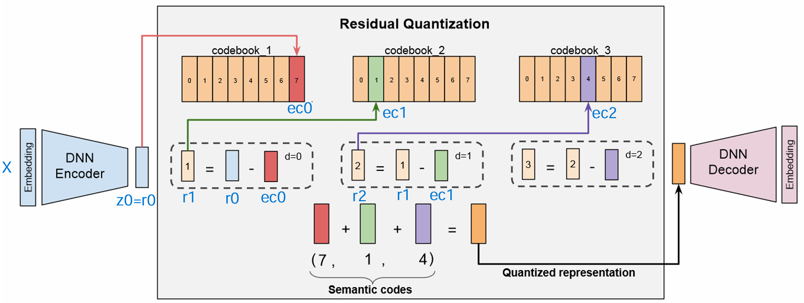
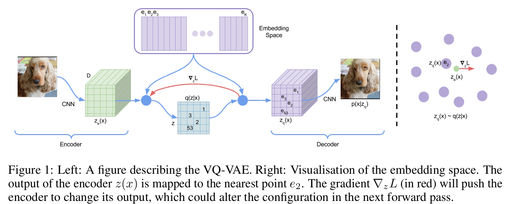

<center>

</center>

生成式推荐（Generative Recommendation）的核心，是把"推荐下一个物品"建模成"生成下一个 token"。但物品动辄上亿、且 ItemID 本身不带任何语义，无法像单词一样被模型直接生成——语义 ID（Semantic ID, SID） 就是为此而生：它将物品 embedding 压缩成一小串离散码字，让语义相近的物品拥有相近的 ID，从而成为生成式模型可学习、可生成的基本单元。

<!-- more -->

本文沿 VQ-VAE → RQ-VAE → RQ-KMeans 的脉络，梳理两类主流的 SID 构建方法：基于神经网络端到端学习的 RQ-VAE，以及直接对 embedding 递归聚类、被快手 OneRec 等采用的 RQ-KMeans。每部分均配原理讲解与代码解析。

# 从VQ-VAE到RQ-VAE

## VQ-VAE

向量量化 (Vector Quantization, VQ) 的核心思想是将一个连续的、高维的向量空间，映射到一个离散的、有限的码本（Codebook）空间中。

<center>

</center>

如上图所示，**VQ-VAE**将这一思想整合进了标准的自编码器（Auto-Encoder）架构中。它由三部分构成：

- **编码器 (Encoder)**：将输入数据 $x$（如图片）压缩成一个低维的连续潜在向量 $z_e$。
- **量化器 (Quantizer)**：通过查找码本，将 $z_e$ 替换为离它最近的码本向量 $z_q$ ，这个查找操作是不可导的，因此VQ-VAE引入了**梯度直通估计器**（Straight-Through Estimator，STE）来解决反向传播中的梯度中断问题。
- **解码器 (Decoder)**：接收量化后的  $z_q$ ，并尝试将其重建为原始输入 $x'$。

训练VQ-VAE包含两个损失（实际是三个，重建一个，量化两个）：
- 一是最小化  $x$ 和  $x'$ 之间的**重建损失**，以保证信息保真度；
- 二是**量化损失**，通过最小化 mse($z_e$, $z_q$) 来让 $z_e$ 和  $z_q$ 相互靠近：
	- **码本损失**：阻断 $z_e$ 的梯度，梯度只通过 $z_q$ 回传至码本用于更新码本
	- **承诺损失(Commitment Loss)**：阻断 $z_q$ 的梯度，梯度只通过 $z_e$ 回传至encoder用于保证 encoder 提取出的隐变量与码本中的向量尽可能接近，稳定训练过程

即损失函数：
$$\mathcal{L} = \underbrace{\|x - x'\|^2}_{\text{重建}} + \sum_{l} \underbrace{\|z_q^l - \text{sg}[z_e^l]\|^2}_{\text{码本}} + \beta \sum_{l} \underbrace{\|\text{sg}[z_q^l] - z_e^l\|^2}_{\text{承诺}}$$
其中 sg = stop gradient表示梯度阻断。

VQ部分（不包括encoder和decoder部分）代码逻辑如下所示：
``` python
class VQEmbedding(nn.Module):
    """
    单层向量量化模块 (Vector Quantization Embedding)。
    包含一个码本 (codebook)，负责将输入向量映射到码本中最接近的向量。
    """
    def __init__(self, num_embeddings: int, embedding_dim: int, commitment_cost: float = 0.25):
        super().__init__()
        self.num_embeddings = num_embeddings
        self.embedding_dim = embedding_dim
        self.commitment_cost = commitment_cost
        
        # 将码本注册为可学习的参数
        self.embeddings = nn.Parameter(torch.randn(num_embeddings, embedding_dim))
        self.initialized_with_data = False
        
    def initialize_from_data(self, data: torch.Tensor):
        """使用K-Means对码本进行一次性初始化，避免随机初始化陷阱。"""
        if self.initialized_with_data:
            return
            
        data_np = data.detach().cpu().numpy()
        n_samples = data_np.shape[0]
        
        if n_samples < self.num_embeddings:
            # 样本不足时，有放回地抽样
            indices = np.random.choice(n_samples, self.num_embeddings, replace=True)
            centroids = data_np[indices]
        else:
            kmeans = KMeans(n_clusters=self.num_embeddings, n_init='auto', max_iter=100)
            kmeans.fit(data_np)
            centroids = kmeans.cluster_centers_
        
        self.embeddings.data.copy_(torch.from_numpy(centroids))
        self.initialized_with_data = True

    def forward(self, z: torch.Tensor):
        distances = (
            torch.sum(z**2, dim=1, keepdim=True) +
            torch.sum(self.embeddings**2, dim=1) -
            2 * torch.matmul(z, self.embeddings.t())
        ) # z离码本中每个向量的L2距离
        
        indices = torch.argmin(distances, dim=1)
        z_q = F.embedding(indices, self.embeddings)
        
        # 计算损失
        codebook_loss = F.mse_loss(z_q, z.detach())  # 用于更新码本
        commitment_loss = F.mse_loss(z, z_q.detach()) * self.commitment_cost  # 用于更新z上游(encoder)
        total_loss = codebook_loss + commitment_loss
        
        # Straight-Through Estimator (梯度直通) 用于解决码本查找不可导的问题
        z_q = z + (z_q - z).detach()
        
        return z_q, indices, total_loss
```

## RQ-VAE：多层VQ

VQ-VAE在处理高保真度数据时面临一个瓶颈：若要精确表示复杂的输入，就需要一个极大的码本，这会带来巨大的计算和存储开销。**RQ-VAE** 通过引入**残差量化 (Residual Quantization)** 机制完美地解决了这个问题。其核心思想是“由粗到精”进行多次VQ：

<center>

</center>

1. **第一层量化**: 与VQ-VAE相同，对原始向量进行一次“粗略”的量化，得到第一个码字；
2. **计算残差**: 计算原始向量与第一次量化结果之间的差值（残差）；
3. **第二层量化**: 不再对原始向量进行操作，而是对残差进行第二次量化，得到第二个码字；
4. **迭代**: 继续计算新的残差，并交给下一层处理。

残差量化代码如下：
```python
class ResidualVQ(nn.Module):
    """
    残差向量量化 (Residual Vector Quantization)。
    包含多个VQEmbedding层，对前一层的残差进行逐层量化。
    """
    def __init__(self, num_layers: int, num_embeddings_list: list, embedding_dim: int, commitment_cost: float = 0.25):
        super().__init__()
        self.num_layers = num_layers
        self.vq_layers = nn.ModuleList([
            VQEmbedding(num_embeddings_list[i], embedding_dim, commitment_cost)
            for i in range(num_layers)
        ])
        
    def initialize_from_data(self, data: torch.Tensor):
        """逐层初始化所有码本。"""
        residual = data.clone()
        for i, vq_layer in enumerate(self.vq_layers):
            print(f"[INFO] Initializing codebook layer {i+1}/{self.num_layers}...")
            vq_layer.initialize_from_data(residual)
            with torch.no_grad():
                quantized, _, _ = vq_layer(residual)
                residual -= quantized
                
    def forward(self, inputs: torch.Tensor, commitment_cost: float = None):
        residual = inputs
        quantized_total = torch.zeros_like(inputs)
        indices_list = []
        loss_total = 0.0
        
        for vq_layer in self.vq_layers:
            # 支持动态传入commitment_cost
            if commitment_cost is not None:
                vq_layer.commitment_cost = commitment_cost
            
            quantized, indices, loss = vq_layer(residual)
            residual = residual - quantized             # 会创建新张量,反向传播需要用到未被修改前的值
            quantized_total = quantized_total + quantized
            indices_list.append(indices)
            loss_total += loss
            
        return quantized_total, torch.stack(indices_list, dim=1), loss_total
```

## 超参设置

RQ-VAE的调参关键是**重建保真度**、**量化稳定性**、和**模型复杂度**三者之间的权衡。

**`num_vq_layers`**：码本层数，越深越保真，但复杂度越高，推荐2~4层。
**`num_embeddings_list`**：各层码本大小，为了避免  **Codebook Collapse**（码本坍塌：过大的码本在不稳定的训练或不足的训练数据下很容易导致编码器只学会使用其中一小部分“安全”的码字，造成大量参数浪费），不应过大，一般256足矣。
**`latent_dim`**：隐向量维度，编码器的输出维度，是模型中的**信息瓶颈**，一般和输入维度有关，**8x到32x**的压缩率是合理的探索起点。
**`commitment_cost`（$\beta$）**：承诺损失系数， $\beta$ 较低 (如 < 0.25)时对编码器的约束力较弱。编码器有更大的“自由”去学习如何映射输入，这可能有利于降低**重建损失**。但如果编码器输出过于“随心所欲”，可能会与码本整体疏远，导致量化困难和**码本坍塌**。$\beta$较高 (如 > 0.25)时对编码器的约束力很强。它会产生一股强大的梯度“拉力”，迫使编码器的输出必须紧密贴合码本。这通常能有效**提升码本利用率**，防止坍塌。但如果约束过强，可能会限制编码器的表达能力，牺牲一部分重建质量。

## 常见问题

### 问题1：码本坍塌

这是训练VQ-VAE/RQ-VAE时最容易遇到的问题。

- **现象**: 训练结束后，通过分析脚本发现码本利用率（Codebook Usage）极低。例如，设定的码本大小为256，但最终只有不到10%（甚至只有个位数）的码字被使用过。同时，`vq_loss`可能会收敛到一个异常低的值。
- **深层次原因**： 码本更新机制的缺陷，未被任何样本选中的码字在该 batch 内梯度为零得不到更新，形成"富者愈富"的马太效应——初始离数据近的码字被频繁选中并持续优化，离得远的码字则永远选不到、永远不更新，最终坍塌。
- **可能原因**:
    1. **初始化不佳**: K-Means初始化步骤未能提供一个良好的码本起始分布。
    2. **学习率太高导致训练不稳定**: 学习率太高导致模型在优化过程中发生“抖动”或“崩溃”，最终收敛到一个“懒惰”的局部最优点，即编码器只输出少数几种潜在向量，因为这样做最容易降低损失。
- **解决方案**:
    1. **降低学习率**: 降低学习率，并配合学习率动态策略使用。
    2. **指数移动平均 (EMA) 更新**：不用梯度下降，而是通过编码器输出的移动平均值来更新码本。这样码本更新方向由真实数据的聚类中心驱动，不受学习率、梯度噪声的直接影响，训练更平滑；本质上更接近 KMeans 的更新逻辑，这也是它能缓解坍塌的原因。使用 EMA 时，码本损失那一项就不再需要，只保留承诺损失。
    3. **引入码本重置 (Codebook Resetting)**: 一种更高级的技巧。在训练中周期性地检测并重置那些长期未被使用的“死亡”码字，例如，将它们重新初始化到高密度数据簇的中心附近。
    4. **减少嵌入维度，增加码本容量**: 降低维度，能够减小潜在向量空间的体积来缩短“潜在向量分布”与“码本向量分布”之间的平均距离，从而让更多的码本向量有机会成为某个潜在向量的最近邻，从而进行码字更新

### 问题2：重建损失过高

- **现象**: 重建损失在训练后期依然维持在较高的水平，无法有效降低，导致重建出的向量与原始向量差异巨大。
- **可能原因**: 模型在“编码-量化-解码”的完整链路中丢失了过多关键信息。
    1. **信息瓶颈过窄**: `latent_dim`设置得太小，在量化前就已经造成了不可逆的信息损失。
    2. **模型容量不足**: 编码器/解码器的网络层数太少或维度太低，不足以学习到从原始空间到潜在空间的复杂映射。
    3. **承诺系数β过高**: 过强的约束力迫使编码器过度关注于对齐码本，而牺牲了对原始信息细节的保留。
- **解决方案**:
    1. **增大潜在向量维度 `latent_dim`**: 这是最直接的解决方式，拓宽了信息瓶颈。
    2. **加深/加宽编解码器网络**: 增加模型的参数量和拟合能力。
    3. **降低承诺系数β**: 适当减小`commitment_cost`，降低编码器对对齐码本的关注度，保留原始细节。

### 问题3：量化损失过高

- **现象**: `vq_loss`（尤其是其中的`commitment_loss`部分）居高不下。
- **可能原因**: 编码器的输出分布与码本的分布始终存在较大差异，两者未能有效“会合”。
    1. **承诺系数β过低**: 对编码器的“拉力”不足，无法有效引导其输出向码本靠近。
    2. **码本容量不足**: 码本的“词汇量”不足以覆盖编码器输出的潜在向量分布。
    3. **初始化不佳**: K-Means初始化阶段未能给码本一个良好的起点。
- **解决方案**:
    1. **增大承诺系数β**: 这是最直接的对策，增强编码器向码本对齐的激励。
    2. **增大码本容量**: 提供更多、更丰富的码字供编码器选择。
    3. **检查并优化初始化**: 确保用于K-Means初始化的数据量足够且具有代表性。


# RQ-Kmeans

RQ-KMeans 与 RQ-VAE 的核心差异在于：它**不训练任何神经网络**，直接对已有的物品 embedding 做递归聚类。这里的 embedding 通常来自预训练模型的产出，比如多模态内容向量、协同过滤向量等，是"固定不动"的输入。

其流程与 RQ-VAE 的残差量化一脉相承，只是把"码本查找 + 反向传播更新码本"换成了"KMeans 聚类得到簇中心"：
1. 第一层聚类：对全体原始 embedding $X$ 执行 KMeans，得到 $K$ 个簇中心作为一级码本，每个样本被分配到最近的簇，簇索引即为 SID 的第一位；
2. 计算残差：每个样本减去其所属簇中心，得到残差 $r = x - c_{\text{level1}}$；
3. 第二层聚类：对上一层的残差再执行 KMeans，得到二级码本与第二位索引；
4. 迭代：继续对新残差聚类，直到达到设定的层数 num_levels，最终每个物品得到一个长度为 num_levels 的 SID。

为什么快手 OneRec 等系列选择 RQ-KMeans：
- 训练成本极低：只是若干次 KMeans，无需 GPU、无需反向传播、无需调 encoder/decoder 与损失权重，几分钟即可跑完百万级物品。
- 结果稳定可复现：固定随机种子后结果确定，不存在 RQ-VAE 那种训练不稳定、需要反复调参的问题。
- 几乎不坍塌：KMeans 会为每个簇分配样本、更新每一个簇中心，天然保证各码字都被使用，码本利用率高，基本不出现 RQ-VAE 中的码本坍塌。
- 可解释性强：每一层就是一次明确的聚类，簇中心即语义原型，便于分析和排查。

代价：RQ-KMeans 的效果**完全依赖输入 embedding 的质量**——它只做量化、不做表示学习，无法像 RQ-VAE 那样通过重建损失端到端地优化表示。如果输入 embedding 本身语义不佳，SID 质量也会受限。

RQ-KMeans代码示例如下：
```python
import numpy as np
from sklearn.cluster import KMeans

class RQKMeans:
    def __init__(self, num_levels, codebook_size, random_state=42):
        """
        num_levels: 残差量化层数（即SID长度）
        codebook_size: 每层码本大小（建议各层相同）
        """
        self.num_levels = num_levels
        self.codebook_size = codebook_size
        self.random_state = random_state
        self.codebooks = []      # 每层的码本中心 (list of np.ndarray)
        self.sids = None         # 所有样本的SID (N, num_levels)

    def fit(self, X):
        """
        X: (N, D) 物品embedding矩阵
        """
        N, D = X.shape
        self.sids = np.zeros((N, self.num_levels), dtype=int)
        residuals = X.copy()   # 当前待量化的残差

        for level in range(self.num_levels):
            # 对当前残差做 KMeans
            kmeans = KMeans(n_clusters=self.codebook_size,
                            random_state=self.random_state,
                            n_init=10)
            kmeans.fit(residuals)
            self.codebooks.append(kmeans.cluster_centers_)   # (K, D)
            labels = kmeans.labels_                           # (N,)

            # 保存当前层索引
            self.sids[:, level] = labels

            # 计算下一层的残差：原残差 - 所属簇中心
            centers = kmeans.cluster_centers_[labels]         # (N, D)
            residuals = residuals - centers

        return self.sids

    def transform(self, X):
        """对新样本生成SID（基于已拟合的码本）"""
        N, D = X.shape
        sids = np.zeros((N, self.num_levels), dtype=int)
        residuals = X.copy()
        for level in range(self.num_levels):
            codebook = self.codebooks[level]   # (K, D)
            # 计算每个样本与所有码本中心的距离
            distances = np.linalg.norm(residuals[:, np.newaxis, :] - codebook, axis=2)
            labels = np.argmin(distances, axis=1)
            sids[:, level] = labels
            centers = codebook[labels]
            residuals = residuals - centers
        return sids

    def fit_transform(self, X):
        self.fit(X)
        return self.sids


# ================== 使用示例 ==================
if __name__ == "__main__":
    # 生成随机物品embedding
    N, D = 10000, 128
    X = np.random.randn(N, D)

    rqkmeans = RQKMeans(num_levels=3, codebook_size=256)
    sids = rqkmeans.fit_transform(X)
    print("RQ-KMeans SID shape:", sids.shape)
    print("第一层簇大小分布:", np.bincount(sids[:, 0])[:5])  # 示例

    # 对新样本推理
    new_X = np.random.randn(10, D)
    new_sids = rqkmeans.transform(new_X)
    print("新样本SID:\n", new_sids)
```


# SID 冲突与去重
无论 RQ-VAE 还是 RQ-KMeans，都可能出现不同物品被映射到完全相同 SID 的情况（即码字序列碰撞）。当两个物品的 embedding 非常接近、在每一层都落到同一个码字时，它们的 SID 会一模一样。这在生成式推荐里是个问题——SID 需要能唯一定位一个物品，冲突会导致解码时产生歧义。

工业界常见解法是在原有 SID 末尾追加一位去重码：对落到同一个 SID 的物品按顺序编号（0, 1, 2, …），把这个编号作为额外的一层。例如 TIGER 论文中，若三层 SID 为 (12, 45, 7) 的物品有多个，就扩展成 (12, 45, 7, 0)、(12, 45, 7, 1) …… 从而保证唯一性。
这样 SID 的长度从 num_levels 变为 num_levels + 1，最后一位不携带语义、仅用于消歧。

# RQ-VAE和RQ-Kmeans对比

| 方法            | 原理             | 训练方式        | 是否容易坍缩 | 优点           | 缺点                     |
| ------------- | -------------- | ----------- | ----- | ------------ | ---------------------- |
| **RQ-VAE**    | DNN压缩表示 + 残差量化 | 反向传播梯度下降    | 是     | 可微、可联合优化重建质量 | 训练较慢，需要调参              |
| **RQ-KMeans** | 递归KMeans残差聚类   | 无监督聚类（无需梯度） | 否     | 快速、可解释、无需GPU | 依赖初始embedding质量，缺乏重建优化 |


